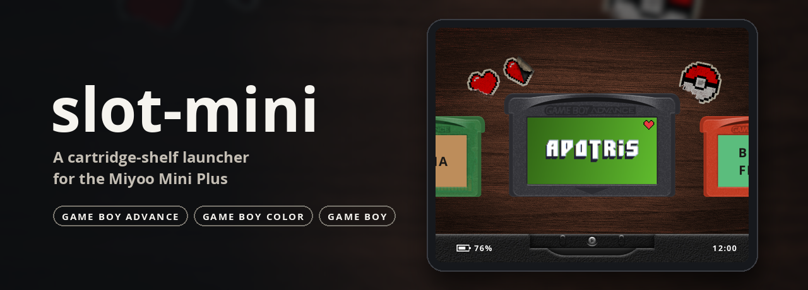
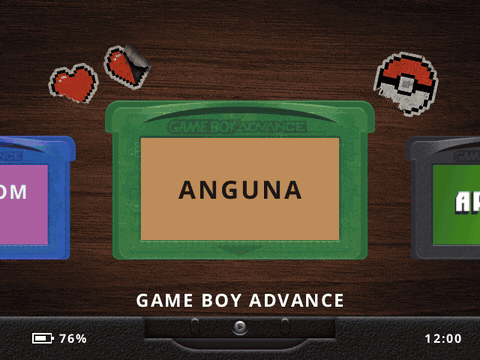

<p align="center">
  
</p>

<p align="center">
  <a href="https://github.com/joecrockett5/slot-mini/actions/workflows/ci.yml"></a>
  <a href="https://github.com/joecrockett5/slot-mini/releases/latest"></a>
  <a href="LICENSE"></a>
  
  <a href="https://github.com/OnionUI/Onion"></a>
  
</p>

<p align="center">
  <a href="#installation">Installation</a> ·
  <a href="#using-slot-mini">Usage</a> ·
  <a href="#labels-shells-and-the-cart-studio">Cart studio</a> ·
  <a href="#slot-mini-pc">PC</a> ·
  <a href="#building-from-source">Building</a> ·
  <a href="#documentation">Docs</a> ·
  <a href="#credits">Credits</a>
</p>

**slot-mini** is a game launcher for the Miyoo Mini Plus running [Onion OS](https://github.com/OnionUI/Onion).
It brings the look and feel of [slot](https://github.com/BrandonKowalski/slot), Brandon Kowalski's frontend for
the Anbernic RG SP, to Game Boy Advance, Game Boy Color and Game Boy games. Your library becomes a shelf of
cartridges, each in its own shell with its own label, and you play a game by sliding it into the slot.

<p align="center">
  
  <br>
  <sub>Recorded from the app itself (<code>scripts/record-demo.sh</code>) on a card of homebrew games.</sub>
</p>

## Highlights

- **slot's shelf on a 640x480 handheld.** slot's cartridge faces, shells, labels, chrome, insert and eject
  animations and sounds, redrawn by a software renderer built for the Mini Plus, which has no GPU.
- **Your library as it is.** Games are read from Onion's own `Roms/GBA`, `Roms/GBC` and `Roms/GB` folders.
  You don't need to move or rename anything.
- **Cart studio.** Pick each cart's shell colour, finish and shape on the device. Labels and shells use slot's
  file format, so labels made with slot's [Cart Studio](https://studio.slot-cfw.fyi) work as they are.
- **Onion underneath.** Games run in Onion's RetroArch with its saves, save states, hotkeys, shaders and Game
  Switcher. slot-mini adds slot's in-game menu and a per-game choice of core (mGBA or gpSP).
- **Optional boot launcher.** Replace Onion's main menu with slot-mini and come back to the cart you just played
  after every game. If slot-mini is ever missing or fails, Onion's menu starts instead.
- **Sync with a PC.** Pair with slot-mini PC and games, saves, labels and hearts stay in step over your own
  Wi-Fi, so you can play on one and carry on from the other.
- **Shelf or grid.** R2 shows a shelf as a grid of carts.
- **Over-the-air updates.** MENU → Check for updates installs new releases over Wi-Fi.

## Installation

**Requirements:** a Miyoo Mini Plus with Onion OS **4.3.1-1** (stable) or Onion's **development build**.
slot-mini detects which one is installed.

1. Download `slot-mini-<version>.zip` from the [latest release](https://github.com/joecrockett5/slot-mini/releases/latest).
2. Unzip it at the root of your SD card, so that `App/slot-mini/` sits beside Onion's other apps. The archive
   contains that folder and nothing else.
3. On the device, open **Apps → slot-mini**.

Each system with an Onion emulator installed gets a shelf. Games in a subfolder one level down are included.

> [!TIP]
> Start in app mode. Once you are happy with slot-mini, make it the boot launcher from its menu
> (see [below](#boot-launcher-optional)). The [device checklist](docs/DEVICE-TESTING.md) walks through every
> feature, and is a good way to try a new version on a spare card.

### Updating

With Wi-Fi on, press **MENU** and choose **Check for updates**. When a newer release is available, the row
becomes **Install update x.y.z**. Press A and slot-mini downloads the release, verifies it, swaps it in and
restarts. Only the app's own files are replaced: settings, favourites, labels and the cache are kept. The
previous files are saved to `App/slot-mini/update/previous/`, so you can undo an update from a computer.

Only numbered releases are offered, never the rolling **Latest main build** pre-release, and slot-mini checks
for updates only when you ask. To follow a fork, set `update_repo = owner/repo` in
`App/slot-mini/data/settings.txt`. You can also unzip a release over `App/slot-mini/` by hand.

### Moving to Onion's development build

1. Update slot-mini first (**MENU → Check for updates**) to 0.5.0 or later.
2. Update Onion with its own updater on the beta channel. The device reboots.
3. Onion's update replaces Onion's own files, so if slot-mini was your boot launcher, Onion's menu is back. Open
   **Apps → slot-mini** once: it restores the boot launcher and tells you so. If you had turned it off, it stays off.

On the development build, GBA games without a core set for them run on gpSP, Onion's new default. Onion copies
each game's mGBA save across the first time it runs there.

### Boot launcher (optional)

Press **MENU** in slot-mini and turn **Settings → Boot launcher** on. slot-mini then starts in place of Onion's main menu,
and every game brings you back to the shelf, on the cart you just played.

- Hold **L2** while slot-mini starts, or choose **MENU → Exit to Onion**, to reach Onion's own menu.
- **MENU → Settings → Boot launcher: Off** restores Onion's menu.
- If slot-mini is missing, crashes or fails to start, Onion's menu starts instead.

slot-mini saves Onion's original `MainUI` binaries to `.tmp_update/slot-mini/stock/` before it replaces
anything. See [how the boot switch works](#how-the-boot-switch-works).

### Splash screens (optional)

**MENU → Settings → Splash screens: slot** shows slot's screens while the device starts and shuts down: the **slot.**
wordmark at boot, and **Powering Down** at power off, whether from Onion's menu, an app or a game.
**Splash screens: Onion** brings back Onion's screens, or your theme's.

The screens are installed as Onion theme overrides (`bootScreen.png`, `Screen_Off.png` and `Screen_Off_Save.png`
in `Saves/CurrentProfile/theme/skin/extra/`), so they work with any theme on both Onion versions. If you had put
overrides there yourself, they are backed up and restored when you switch back. Onion still draws its version
number in the bottom-left corner (and the battery level in the top-right corner at power off), as it does on
every theme. If Tweaks' "Reset theme overrides" removes them, slot-mini reinstalls them the next time it starts.

### Uninstalling

1. If the boot launcher is on, turn it off (**MENU → Settings → Boot launcher: Off**).
2. If slot's splash screens are on, turn them off (**MENU → Settings → Splash screens: Onion**).
3. Delete `App/slot-mini/`.

If you deleted the app with the boot launcher still on, Onion's menu still starts, because the launcher falls
back when slot-mini is missing. To remove it by hand, copy each `.tmp_update/slot-mini/stock/<name>/MainUI`
back over `.tmp_update/bin/<name>`, then delete `.tmp_update/slot-mini/`. Updating Onion also restores its menu.

`Labels/` is in slot's format, so you can keep it. slot-mini's own settings live in `App/slot-mini/data/` and
are removed with the folder.

## Using slot-mini

### On the shelf

| Input | Action |
| --- | --- |
| Left / Right | Browse the shelf (hold to scroll) |
| Up / Down | Jump to the previous or next letter |
| L1 / R1 | Switch shelves: Recents, Favorites, GBA, GBC, GB |
| R2 | Show this shelf as a grid, or as a shelf again (each shelf remembers) |
| A (tap) | Insert the cart and resume from its auto save state |
| A (hold) | Insert the cart and start fresh, without loading the state |
| Y | Heart or un-heart the cart (hearted carts get a Favorites shelf) |
| X | On the Recents shelf: take the cart off it (the game is not touched) |
| SELECT | Open the cart studio |
| START | GBA carts: open the cart and choose its core (mGBA or gpSP) |
| MENU | slot's About sticker (credits, version, battery); Settings (sounds, in-game menu, the Recents shelf, boot launcher, splash screens, online labels, the shelf or grid view, Sync), Sync now once paired with a PC, Check for updates, Exit to Onion |

Holding A starts the game the way Onion's own **Reset game** does, for that one run. RetroArch still writes its
auto state when you quit.

The **Recents** shelf holds the last ten games you started from slot-mini, newest first, and appears once you
have played something. **MENU → Recents: Off** hides it; the list is still kept. Games started from Onion's menu
are not on it.

**R2** turns the shelf you are on into a grid of carts, four rows to a screen, and back; **MENU → Settings →
View** does the same. The D-pad moves in all four directions there, and everything else works as on the shelf.

### In a game

| Input | Action |
| --- | --- |
| MENU (tap) | Pause behind slot's in-game menu: Resume, Save State, Load State, Settings (RetroArch's menu), Game Switcher (Onion's), Exit Game |
| MENU (hold about a second) | Eject: RetroArch writes its auto state and quits to the shelf |
| MENU + any button | Onion's and RetroArch's hotkeys, unchanged (MENU + R2 save state, MENU + L2 load state, MENU + R fast forward, …) |

The menu opens instantly, because a small helper waits beside each game slot-mini launches. If any other button
is pressed with MENU, in any order, slot-mini treats it as a hotkey and stays out of the way. On Onion's
development build, **Game Switcher** opens over the paused game, as Onion's own menu does there. On 4.3.1-1 the
game closes first. Games started from Onion's menu keep Onion's MENU, and **MENU → In-game menu: Off** hands MENU
back to Onion everywhere.

### Sync with a PC

slot-mini can keep its games, saves, labels, shells and hearts in step with [slot-mini PC](#slot-mini-pc) over
your home Wi-Fi. Nothing is sent anywhere else, and nothing happens until you pair.

- **Pair:** open slot-mini on the PC, then **MENU → Settings → Sync → Pair with a PC** on the Miyoo. Pick the PC,
  check that both show the same six-digit code, press A, and confirm on the PC.
- **MENU → Sync now** copies games and saves both ways and says what moved. B stops it safely.
- **Auto sync** (on by default once paired) syncs saves by itself, on Wi-Fi: when slot-mini starts, when the PC
  says a game was closed there, just before a game starts (the game waits at most about a second for it) and
  after you eject. If the PC cannot be reached, nothing is said and the game starts with the save on the card.
- A small icon beside Wi-Fi shows the last sync: a tick, two arrows while syncing, a cross when the PC was not
  reached, and "!" for a conflict.
- **Conflicts:** if a game was played on both since they last synced, the later save is used and the other is
  kept on the PC, where Sync → Conflicts can swap them.
- **Space:** sync leaves 64 MB of the card free. Games that do not fit are left out and counted in the summary.
- **Unpair** (two presses of A) forgets the PC and deletes nothing.

One gap: a game started from Onion's own menu, not from slot-mini, is synced the next time slot-mini starts,
not around the game. The rules are in [docs/SYNC.md](docs/SYNC.md).

### Cores (GBA)

**START** opens the cart, as in slot: the chip sits in the socket of the core the game runs on. Left and Right
move it between **mGBA** and **gpSP**. A keeps the change and B cancels it. The default is Onion's: mGBA on
4.3.1-1, gpSP on the development build. The choice is stored as Onion's own per-game setting
(`Roms/GBA/.game_config/<game>.cfg`), so Onion's Game List Options shows the same core.

RetroArch keeps saves per core, so when the core changes, slot-mini carries the in-game save across, as Onion's
**Transfer mGBA save** does. A save it would overwrite is kept as `<game>.srm.bak_<time>`, and the new core's old
auto state is set aside the same way, so the game resumes from the save you just carried. Each core has its own
save-state format, so save states stay with their core.

## Labels, shells and the cart studio

slot-mini reads the files slot's [Cart Studio](https://studio.slot-cfw.fyi) writes, at the root of the SD card:

- **`Labels/GBA/<rom name>.png`** (and `Labels/GB/`, `Labels/GBC/`): label art, scaled to cover and cropped from
  the centre. GBA labels are 1.94:1, Game Boy and Game Boy Color labels 1.12:1.
- **`Labels/cart_shell.txt`**: one line per game, `<rom name> = <shape> <hex colour> <finish>`, for example
  `Metroid Fusion (USA) = auto 6a3fa0 solid`. The shape is `auto`, `notched` or `rounded`, and the finish is
  `solid`, `clear` or `glitter`. Lines that can't be read are skipped.

The ROM name is the file name without its extension. A cart without label art gets slot's generated text label.

**On the device**, SELECT opens the cart studio for the selected cart. You can set the shell colour, the finish
and, for Game Boy carts, the shape. Changes are saved to `Labels/cart_shell.txt` in the same format.

**The label printer** fetches labels from slot's art service (`art.slot-cfw.fyi`). With Wi-Fi up, slot-mini
also fetches labels for unlabelled carts in the background. It never replaces a label file you already have.
It is on by default; **MENU → Settings → Online labels: Off** turns it off, and the printer then points you
to Cart Studio.

<details>
<summary><b>Using Cart Studio with an Onion card</b></summary>

Cart Studio expects a slot card, with games in `Games/<system>/` beside `Labels/`. Onion keeps them in
`Roms/<system>/`, and slot-mini does not need `Games/`. Until Cart Studio can read Onion's layout, use one of
these:

- **On a computer (recommended):** create `Games/GBA`, `Games/GB` and `Games/GBC` holding copies of your ROMs
  (only the file names matter). Run Cart Studio on that folder, then copy the `Labels/` folder it writes to the
  root of your SD card.
- **On the card:** create `Games/GBA` etc. at the SD root with copies of the ROMs you want labels for. Run Cart
  Studio on the card, then delete `Games/`. This needs room for the copies.

</details>

## Customisation

- **Wallpaper:** put `.png` files in `Wallpapers/` at the SD root, and slot-mini picks one at random each time it
  starts (slot's wood otherwise). Any size works: images are scaled to cover and cropped. A file named after a shelf
  (`GBA.png`, `GBC.png`, `GB.png`, `Favorites.png` or `Recents.png`, in any case) is that shelf's own wallpaper, as in
  slot, and is never one of the random picks; shelves without one keep the random wallpaper.
- **Theme:** copy `App/slot-mini/theme.txt.example` to `theme.txt`. `appearance = light` selects slot's light look,
  and `footer_ink`, `heart_ink` and `wallpaper_tint` adjust the colours.
- **Sounds:** slot's cartridge insert and eject sounds, under **MENU → Sounds** (off by default). They are played
  with Onion's `ffplay`. Turning them on plays the insert sound as a test, and the menu then shows how the player
  finished. With Onion's logging on, its output also goes to `.tmp_update/logs/slot-mini.log`.

<details>
<summary><b>Files slot-mini writes</b></summary>

| File | Contents |
| --- | --- |
| `App/slot-mini/data/settings.txt` | Sounds, in-game menu, the Recents shelf, boot launcher, splash screens, label service, clock format, Auto sync |
| `App/slot-mini/data/state.txt` | The shelf and cart you were on |
| `App/slot-mini/data/favorites.txt` | Hearted carts, in slot's format |
| `App/slot-mini/data/recents.txt` | The last ten games started from slot-mini, in slot's format |
| `App/slot-mini/data/views.txt` | Which shelves are shown as a grid |
| `App/slot-mini/data/sync/` | Only once paired: the PC's name and key, what was last synced, how the last sync ended |
| `Roms/`, `Saves/CurrentProfile/saves` and `states`, `Labels/` | Only when a sync brings games, saves or labels from the PC |
| `App/slot-mini/cache/` | Scaled labels, ROM headers, the art index, sound clips |
| `App/slot-mini/*`, `App/slot-mini/update/` | Only when installing an update: the new files, and the replaced ones in `update/previous/` |
| `Labels/cart_shell.txt`, `Labels/<sys>/*.png` | Only when you change a cart in the studio or fetch labels |
| `Roms/recentlist.json` | On each launch, as Onion's MainUI does, so Onion's Recents and the Game Switcher work |
| `.tmp_update/slot-mini/stock/`, `.tmp_update/bin/MainUI-*` | Only when the boot launcher is turned on |
| `bootScreen.png`, `Screen_Off.png`, `Screen_Off_Save.png` in `Saves/CurrentProfile/theme/skin/extra/` and `.tmp_update/slot-mini/` | Only when slot's splash screens are turned on: slot's screens, and backups of any you had |

</details>

### How the boot switch works

Onion's runtime loop (`.tmp_update/runtime.sh`) bind-mounts one of `.tmp_update/bin/MainUI-<model>-<clean|expert>`
over `miyoo/app/MainUI` and runs it whenever the main menu is due. Turning the boot launcher on:

1. copies each of those files to `.tmp_update/slot-mini/stock/<name>/MainUI`, flushes it to disk and reads it
   back to check it;
2. only then writes a small shell script beside the original and renames it into place.

If this is interrupted at any point, the card has either Onion's original or the script, with the original
safely saved. The script ([package/shim.sh](package/shim.sh)) runs slot-mini. It starts Onion's saved menu
instead when slot-mini is missing, fails or crashes, when L2 is held, when `.tmp_update/slot-mini/DISABLED`
exists, or when you choose Exit to Onion. It runs under the name `sh`, because Onion's key monitor treats any
process named `MainUI` as its menu. Turning the boot launcher off copies the originals back, and never over a
file that is not slot-mini's script (an Onion update may already have restored its own).

## slot-mini PC

The same shelf on Windows, in front of your own standalone [RetroArch](https://www.retroarch.com). It reads a
library folder laid out like an Onion SD card (`Roms/GB`, `Roms/GBC`, `Roms/GBA`, `Saves`, `Labels`), so labels,
shells, favourites and saves mean the same thing on both, and it is the hub a Miyoo syncs with over Wi-Fi (see
**Sync** below).

**Install.** Download `slot-mini-pc-<version>-windows-x64.zip` from the newest
[release named "slot-mini PC"](https://github.com/joecrockett5/slot-mini/releases), unzip it anywhere and run
`slot-mini-pc.exe`. There is no installer. The exe is not signed, so Windows SmartScreen may say "Windows
protected your PC": choose **More info**, then **Run anyway**.

**First run.** RetroArch is looked for in the usual places (its installer's folder, a portable copy, Steam,
Scoop); MENU -> Folders points at it if it is elsewhere, shows which cores are missing and can fetch them from
libretro's buildbot. The library starts empty at `%USERPROFILE%\slot-mini`, and the first screen offers three
ways to fill it: press A to pair a Miyoo and bring its library over by Wi-Fi; press START (Space) to import the
games, labels, shells, favourites and saves from a Miyoo's SD card (nothing on the card is changed, nothing in
the library is replaced); or copy ROMs into its `Roms` folders yourself.

**Sync.** slot-mini PC keeps its library in step with your Miyoo's: games, labels, box art, cart shells,
favourites and saves, so you can play on one and carry on from the other. It needs slot-mini 0.7.0 or later on the
Miyoo ([Sync with a PC](#sync-with-a-pc)), and both on the same Wi-Fi network.

- *Windows Firewall.* The first time slot-mini PC runs, Windows asks whether to let it through. Choose **Allow**
  with **Private networks** ticked. If you chose Cancel, the Miyoo will not find the PC: open Windows Security ->
  Firewall & network protection -> Allow an app through firewall -> Change settings, and tick `slot-mini-pc`
  under Private. MENU -> Settings -> Sync -> "Miyoo can't find this PC?" says the same. Sync uses TCP and UDP
  port 24735 and only ever talks to your own network.
- *Pairing.* MENU -> Settings -> Sync -> Pair a Miyoo (or A on the first screen), then on the Miyoo open MENU,
  choose Sync and pick this PC. Both screens show a six-digit code: confirm on both only if they match. Then
  choose Sync now on the Miyoo; the PC shows the games arriving and its shelves fill as they do.
- *After that* Sync now on either side brings the two in step, and the PC asks the Miyoo by itself each time
  you close a game on the PC. A small icon left of the clock shows a sync running, a conflict, or a sync that
  failed, and the shelf says in a line what each sync moved.
- *Conflicts.* If a game was played on both since they last synced, the later save is the one in use and the
  other is kept. The cart wears an amber "!", and Sync -> Conflicts shows both copies, where each came from and
  when it was last played. "Use the other copy" swaps them; "Keep this one" puts the other away in
  `Saves/slot-mini-removed` after asking.
- *Remove everywhere.* Delete, a right click on the selected cart, or MENU -> Remove this game takes a game off
  this PC and, at its next sync, off every paired Miyoo. It asks first and says what goes. Saves are not
  deleted: they are moved to `Saves/slot-mini-removed/<system>` on each side.
- The PC's name (what the Miyoo lists) and the paired Miyoos, with Unpair, are on the same Sync page.

| | Controller | Keyboard |
| --- | --- | --- |
| Browse | D-pad or left stick | Arrow keys |
| Jump a letter | Up / Down | Up / Down, Page Up / Page Down |
| Play | A | Enter or Z |
| Back | B | X |
| Heart / unheart | Y | A |
| Switch system | L1 / R1 | Q / W |
| Grid / shelf | R2 | 2 or Tab |
| Choose the core | START (Menu on an Xbox pad) | Space |
| Cart studio | X | Backspace |
| Take a cart off Recents | Click a stick | S |
| MENU | SELECT (Back / View on an Xbox pad) | Esc or F1 |
| Remove a game everywhere | (MENU) | Delete |
| Full screen | | F11 or Alt+Enter |

A, B, X and Y go by an Xbox controller's labels (A at the bottom); MENU -> Settings -> Controller switches to the
Miyoo's layout (A on the right). A bar above the footer lists these shortcuts for whatever you last touched,
controller or keyboard. Pick up the mouse and the bar and every legend become buttons: PLAY (hold it to start a
game from the beginning), FAVE, STUDIO, the shelf arrows, CORE, GRID / ROW and MENU, so everything can be done by
clicking. Clicking a cart chooses it, a double-click plays it, the wheel browses and the right button goes back
(on the selected cart it asks about removing the game everywhere). MENU also holds full screen, the folders,
Sync, Import from SD card, Check for updates (it opens the download page) and Quit.

A game opens where slot-mini is: full screen when slot-mini is full screen, otherwise in a window in the same
place. The picture is drawn at whole multiples of 640x480 (up to four times), so labels and text stay sharp on a
large window, with plain black bars where the window is not 4:3.

Settings live in `%APPDATA%\slot-mini-pc\config.txt`. Only one slot-mini runs at a time; starting it again
brings the first to the front. To build it: `cargo build --release -p slot-mini-pc` on Windows. Its checklist
for a real PC is [docs/pc/TESTING.md](docs/pc/TESTING.md).

## Building from source

The Rust toolchain is pinned in `rust-toolchain.toml`, and rustup installs it automatically. The device build
also needs `clang`, `lld` and `llvm`.

Create a simulated Onion SD card with a few header-only ROMs, then run slot-mini in a 640x480 window:

```bash
cargo run --features slot-mini/desktop -- --make-fake-sd sdcard
```

```bash
cargo run --features slot-mini/desktop -- --sd sdcard --tmp /tmp
```

Desktop keys: arrows, Z = A, X = B, A = Y, S = X, Q / W = L1 / R1, Backspace = SELECT, Escape = MENU.

Build for the device, then package the release zip into `dist/`. The device build is a static 32-bit ARM
binary for the Cortex-A7, with NEON, linked with `rust-lld`.

```bash
cargo build --release --target armv7-unknown-linux-musleabihf -p slot-mini
```

```bash
scripts/package.sh
```

### Testing

```bash
cargo test --workspace
```

```bash
SLOT_MINI_BIN=target/debug/slot-mini sh package/tests/test-shim.sh
```

- **Golden images** of every screen at 640x480 (`crates/slot-mini/tests/golden/`). `UPDATE_GOLDEN=1` rewrites
  them, and [docs/DESIGN-PARITY.md](docs/DESIGN-PARITY.md) shows them beside slot's own.
- **Whole launch cycles** against a stand-in for Onion's runtime loop (`crates/slot-mini/tests/fake-runtime.sh`).
- **The label service** against a local HTTP server, never the internet.
- **Device backends** (framebuffer, input, audio, battery) tested off the device. The whole suite also runs on
  armv7 under `qemu-arm-static` in CI.
- **The boot shim** and its install and restore switch (`package/tests/test-shim.sh`).

To run the armv7 suite locally:

```bash
CARGO_TARGET_ARMV7_UNKNOWN_LINUX_MUSLEABIHF_RUNNER=qemu-arm-static cargo test --release --target armv7-unknown-linux-musleabihf --workspace
```

The demo and banner in this README are made from the app itself. `scripts/record-demo.sh` drives slot-mini
headlessly and encodes `docs/media/demo.gif` (it needs `ffmpeg`), and `scripts/banner.py` draws
`docs/media/banner.png` from the recording (it needs Pillow).

### Releases

CI ([`.github/workflows/ci.yml`](.github/workflows/ci.yml)) builds and tests every push and pull request on the
desktop, and runs the full suite on armv7 under qemu. On `main`, the armv7 job also builds the release binary,
tests it and packages the zip. Once everything passes, the `release` job
([`scripts/release.sh`](scripts/release.sh)) publishes it:

- if `v<version>` from the workspace `Cargo.toml` has not been released yet, it creates a release with that tag;
- otherwise it refreshes the rolling `main-latest` pre-release.

To ship a new version, bump `version` in `Cargo.toml` and merge to `main`.

The PC app has its own release line. The Windows job builds `slot-mini-pc.exe`, the `pc-package` job zips it
([`scripts/package-pc.sh`](scripts/package-pc.sh)), and on `main`
[`scripts/release-pc.sh`](scripts/release-pc.sh) publishes `pc-v<version>` from
`crates/slot-mini-pc/Cargo.toml` when that version has no release yet. PC releases are never marked as GitHub's
latest release, which is what the Miyoo's updater asks for; from 0.6.6 the Miyoo also ignores any tag that is not
exactly `v<x.y.z>`.

## Documentation

| Document | Contents |
| --- | --- |
| [PLATFORM.md](docs/PLATFORM.md) | What slot-mini relies on in Onion and the hardware, checked against Onion's and Open MainUI's source |
| [DESIGN-PARITY.md](docs/DESIGN-PARITY.md) | Every slot screen and effect, how slot-mini reproduces it, and side-by-side images |
| [SYNC.md](docs/SYNC.md) | How a Miyoo and slot-mini PC keep a library in step: what syncs, the rules, the protocol and the `slot-mini-sync` crate |
| [DECISIONS.md](docs/DECISIONS.md) | Design decisions and the reasons for them |
| [PROGRESS.md](docs/PROGRESS.md) | Changes by version, performance figures and open questions |
| [DEVICE-TESTING.md](docs/DEVICE-TESTING.md) | A step-by-step checklist for a real Mini Plus |
| [sync/DEVICE-PROGRESS.md](docs/sync/DEVICE-PROGRESS.md) | Where sync and the grid on the Miyoo stand |
| [pc/TESTING.md](docs/pc/TESTING.md) | The same for the Windows app |
| [pc/PROGRESS.md](docs/pc/PROGRESS.md) | Where the Windows app stands |

## Roadmap

Possible next steps, roughly in order of effort:

- Re-tinting **logo labels** after the studio is closed (slot keeps the logo so it can re-tint it).

Not planned: other Onion systems, a core picker for Game Boy carts, and features that belong to RetroArch or to
slot's own frontend, such as save-state browsing, rewind, shaders, bezels, colour grading, link play, slot's web
companion and RomM.

## Credits

slot-mini exists because of **[slot](https://github.com/BrandonKowalski/slot)** by
**[Brandon Kowalski](https://github.com/BrandonKowalski)**. The shelf, cartridge faces and shells, slot's chrome
and footer, the cart studio, the label service client, ROM scanning, the label and shell file formats, the boot
and shutdown screens and the insert and eject sounds are slot's design, code and assets, adapted for a 640x480
screen without a GPU. Every file copied from slot names its source file and the slot commit it came from
(`e66715d`), and describes what changed. If you have an RG SP, use slot.

- **Art:** slot's skeuomorphic artwork is by **Markus** ([MarkusMaribu](https://github.com/MarkusMaribu)).
- **Fonts:** [Open Sans](https://fonts.google.com/specimen/Open+Sans) (SIL Open Font License 1.1) and
  [Symbols Nerd Font Mono](https://github.com/ryanoasis/nerd-fonts) (MIT), as shipped with slot.
- **Platform:** [Onion OS](https://github.com/OnionUI/Onion) and
  [Open MainUI](https://github.com/robcodedev/onionos-mainui-opensource). Their source documents the runtime
  loop, launch commands, key map, Recents format and how to replace MainUI safely. No code from either is included.
- **Demo:** the demo card uses the titles of freely available homebrew games (Anguna, Apotris, Butano Fighter,
  Celeste Classic, Goodboy Galaxy, Varooom 3D, Dangan GB, Infinity, Shock Lobster, Tobu Tobu Girl, Deadeus,
  Libbet and the Magic Floor, Petris). The ROMs are empty headers, and the Apotris label is slot's example
  label art.
- **Rust crates:** listed with their licences in `App/slot-mini/licenses/THIRD-PARTY.txt` in each release.

slot-mini is an independent project. It is not affiliated with or endorsed by slot, Onion OS or Miyoo.

## Licence

slot-mini is released under the **GNU General Public License v3.0 or later** ([LICENSE](LICENSE)), the licence
of the slot code it is built from. (slot's README badge says MIT, but its workspace is GPL-3.0-or-later.) Every
release ships slot's licence as `licenses/slot-GPL-3.0.txt`, together with the font licences and the licence of
every Rust crate.

## AI disclosure

slot-mini was written by Claude, Anthropic's AI model, working from a written brief: the research into Onion,
the Rust code, the shell scripts, the tests and this documentation. The maintainer tests it on a Miyoo Mini
Plus. slot's own frontend was also built with Claude, as slot's
[AI page](https://github.com/BrandonKowalski/slot/blob/main/site/docs/ai.md) explains. slot's art is Markus's,
and its design is Brandon Kowalski's.
