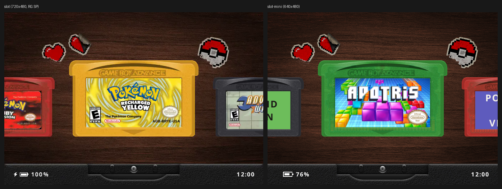
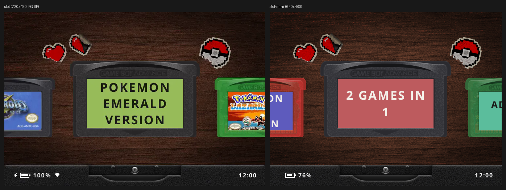
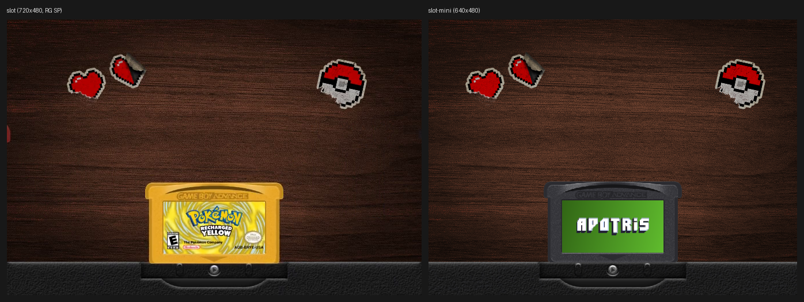
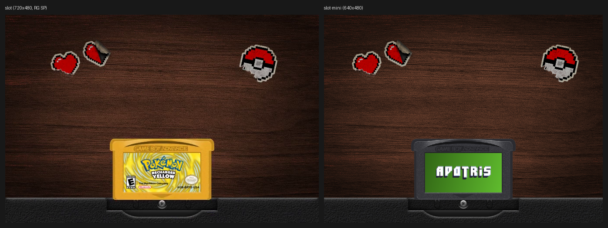

# Design parity with slot

slot draws its frames as a list of `Draw` operations (`slot-gfx/src/draw.rs`):
textured rectangles, sub-rectangles, solid rectangles, rotated rectangles
(`Turned`), free quads (`Quad`), a paper-curl shader (`Paper`), the game and a
screenshot. Almost every texture is built on the CPU first (`slot-ui/src/cart.rs`
composes a cart from its shell bitmap, label and finish into one RGBA image),
and the GPU only places, scales and blends them.

That makes the port mostly mechanical. slot-mini keeps slot-ui's layout code
(shelf, cart faces, slot chrome, footer) and its `Draw` list, and replaces the
GL pipeline with a software rasteriser (`crates/slot-mini-gfx`) that understands
`Rect`, `Tex` and `Part`. The other operations are either pre-rendered once
when a screen opens, or dropped, as listed below.

Reference images were taken from slot's own site media
(`reference/slot/site/docs/media/*.webp` and frames of the `.mp4` clips), copied
to `docs/reference/`. slot's render tests could not be used: its headless GL
surface is macOS-only (`slot-gfx/src/lib.rs`, `#[cfg(target_os = "macos")]`),
and the brief forbids building slot anyway. The site media is 720x480, the RG
SP layout; slot's 4:3 layout is the same code with a 640-wide `Canvas`
(`Canvas::of((640, 480))` in `slot-gfx/src/layout.rs`), which is what
slot-mini renders.

## Screens

| slot screen | In scope | slot-mini |
| --- | --- | --- |
| Shelf (carousel) | yes | Same layout code (`shelf.rs`, copied). Wallpaper, carts, slot chrome, platform title, footer. |
| Favourites shelf | yes | slot's own Favourites shelf, listed before GBA, GBC and GB as in `site/docs/guide/shelf.md`. |
| Recents shelf | no | Onion's Game Switcher already covers this. Roadmap. |
| GBA Video shelf | no | Not a separate Onion system. |
| Insert (cart slides into the slot) | yes, simplified | The cart drops into the slot mouth over ~300 ms, the insert sound plays, then slot-mini exits. |
| Eject (cart rises out of the slot) | yes, simplified | When slot-mini starts straight after a game it opens on that cart and plays the rise in reverse. |
| Cart Studio (SELECT) | yes, simplified | Cutting-mat ground, the cart on the left, rows on the right: Label Printer, Shell (GB only), Shell Colour, Finish. See below. |
| Label printer and slips | yes, simplified | Two choices (scanned label, logo label) shown as flat slips; no print/tear animation. |
| About (MENU) | yes | slot's sticker on the menu ground, plus slot-mini's own rows: boot launcher switch, sounds, exit to Onion. |
| Settings (quick menu) | partly | Folded into the About screen: only settings slot-mini needs. |
| Core picker, save-state switcher, in-game menu, link, RomM, Wi-Fi setup, clock setting, brightness, update | no | Out of scope (RetroArch and Onion own these). |

## Shelf details

| Element | slot | slot-mini |
| --- | --- | --- |
| Cart faces | `cart_face`: shell bitmap tinted with the shell colour (overlay blend), label pasted into the window, silhouette clip, console stamp. | Same code, run once per cart and cached as a composited sprite on the SD card (`App/slot-mini/cache/`). |
| Finishes | Solid; clear (shell at alpha 204 with the board and back shell drawn behind); glitter (a deterministic fleck pattern baked into the face). | All three kept. Clear carts are flattened with their board and back shell into one sprite at cache time, so the shelf blends one image per cart instead of three. |
| Text labels | `generated_label`: name in up to three lines on a colour picked from the title hash. | Same code with slot's Open Sans Bold. |
| Side carts | Scaled by 0.78, full alpha, centre cart at 1.0, scale eased with distance. | Same maths. Each cart sprite is kept at 1.0 and 0.78; in-between scales use a nearest-neighbour scaled blit from the 1.0 sprite only while a cart is moving. |
| Scrolling | Critically damped spring, `OMEGA = 16`, key repeat after 400 ms then 110/85/65/50 ms. | Same code. |
| Heart | Pixel heart sticker on the label corner (`HEART_INK`). | Same. |
| Slot | `slot_front_*.png` and `slot_back_*.png` bitmaps, dark and light. | Same bitmaps, cropped to the 640 canvas as slot does on 4:3 panels. |
| Platform title | Platform name above the slot, fades out after switching. | Same timing. |
| Footer | Battery gauge and percentage on the left, clock on the right, Wi-Fi icon after the battery, ink colour by theme. | Same layout; battery from `/tmp/percBat`, no charging bolt (see `PLATFORM.md`). |
| Button legend | Menu screens show B/A legend plates in the footer. | Same, using slot's `buttonlegend_*.png` assets. |
| Wallpaper | `Wallpapers/*.png` scaled to cover and centre-cropped; Random picks one at boot. | Random at boot from `Wallpapers/` in slot-mini's app folder or on the SD root; slot's `background_default.png` otherwise. Scaled once at start-up, not per frame. |
| Theme | Dark or Light appearance (`settings.md`) stored in slot's `key = value` config format. | `theme.txt` in slot-mini's app folder, same `key = value` format (slot's `ini.rs` parser): `appearance = dark|light` plus optional colour overrides. |

## Effects that slot does on the GPU

| Effect | Where slot uses it | slot-mini |
| --- | --- | --- |
| LCD3x subpixel mask | In-game screen | Dropped: in-game is RetroArch's. |
| Colour grading (saturation, contrast, blue light, dim) | In-game and the whole frame | Dropped (out of scope). |
| Background blur | Menu ground behind the quick menu (`background_default_blur.png`) | Baked: slot ships the blurred default as a PNG; slot-mini uses it. Custom wallpapers are box-blurred once on the CPU when a menu first opens. |
| Sticker paper curl (`Draw::Paper`) | About sticker peel, print slips | Baked flat: the sticker is drawn without the curl. |
| Rotated carts (`Draw::Turned`) | Studio cart tilt, link screen | The studio cart is rotated once in software when the studio opens and then blitted as a flat sprite. |
| Free quads (`Draw::Quad`) | Unwrap and apply-label animations | Dropped. A new label simply appears on the cart. |
| Bilinear scaling | Everywhere | Pre-scaled sprites; nearest-neighbour only during motion. |
| Alpha blending | Everywhere | Software `src-over` with 8-bit alpha, skipping fully transparent and fully opaque runs. |

## Side by side

slot's reference frames are 720x480 (the RG SP); slot-mini renders at 640x480,
which crops the shelf the way slot's own 4:3 layout does. Cart content differs
because the fixtures differ: slot-mini's golden tests use a fake card whose
labels are slot's own example art (`assets/fetch_example_*.png`). Regenerate
with `scripts/parity.py <name> <slot png> <golden png>`.

### Shelf with label art

slot-mini: `crates/slot-mini/tests/golden/shelf_real_label.png`. Same cart
sizes and positions, slot chrome, footer and wallpaper. slot shows a charging
bolt; slot-mini never does (see `PLATFORM.md`).

### Shelf with a text label

slot-mini: `shelf_gba.png`. slot's generated label: the name in up to three
lines on a colour picked from the title.

### Insert

slot-mini: `insert.png`, 200 ms after tapping A. slot's timing (0.45 s to
seat, 0.28 s hold) and travel curve (`SlotChrome`, copied). Like slot, the
footer is hidden while a cart moves. slot then powers the screen on into the
game; slot-mini exits and Onion's RetroArch takes over.

### Eject

slot-mini: `eject.png`, 200 ms after starting again as the boot launcher
following a game. slot ejects out of the running game picture; slot-mini
starts with the cart seated and lifts it back onto the shelf.

### Other shelf goldens

All in `crates/slot-mini/tests/golden/`:

| Golden | Shows |
| --- | --- |
| `shelf_gba_named.png` | The platform name above the slot, as after a switch |
| `shelf_mid_scroll.png` | A frame mid-scroll: side carts scaling between 0.78 and 1.0 |
| `shelf_logo_label.png` | A logo label on a solid shell |
| `shelf_gbc.png` | A Game Boy Color shelf, clear shell with the board showing |
| `shelf_gb_named.png`, `shelf_gb_glitter.png` | Game Boy paks, a glitter finish from `cart_shell.txt` |
| `shelf_light_wallpaper.png` | Light appearance, a custom wallpaper with tint, Wi-Fi icon, low battery |
| `empty.png` | No games on the card |
| `relaunch_same_cart.png` | The launcher started again by the fake runtime loop after a game, on the same cart |
| `refused_name.png` | A file name Onion cannot launch (`:` in it), refused with a message |
